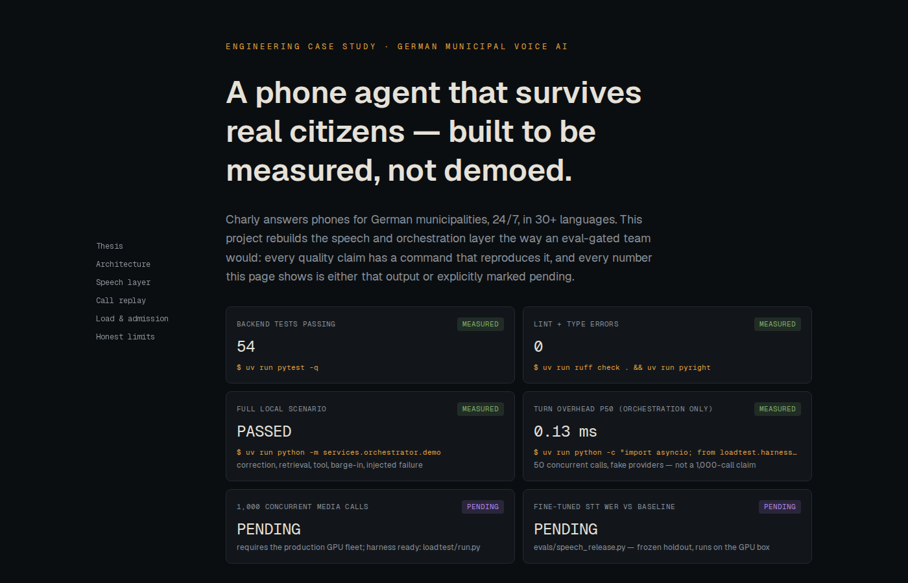
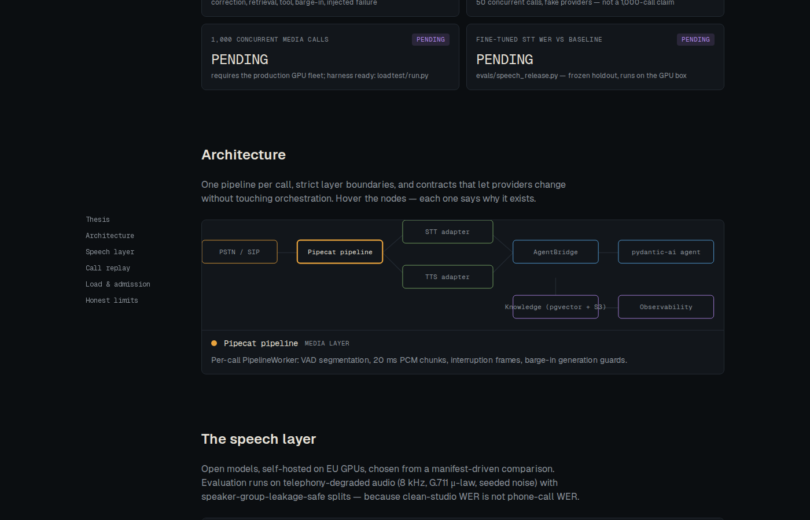
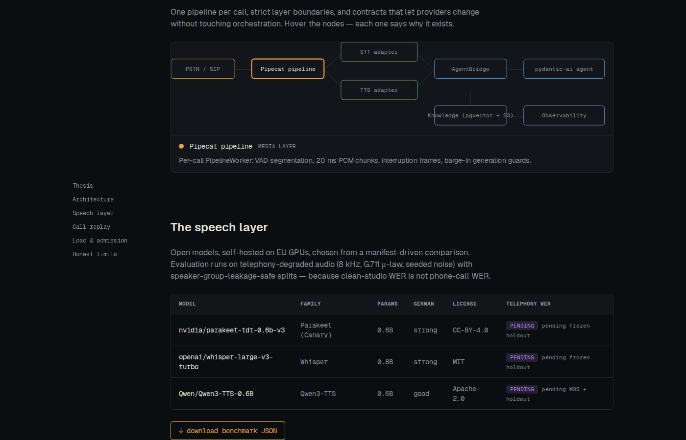
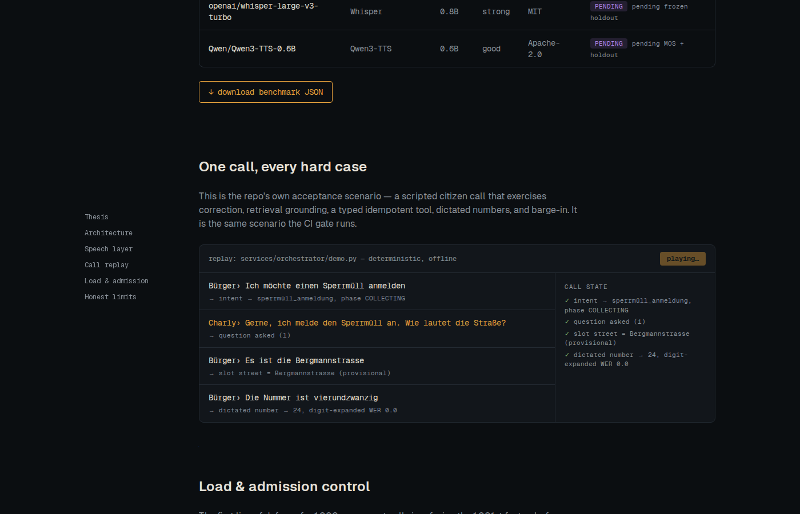
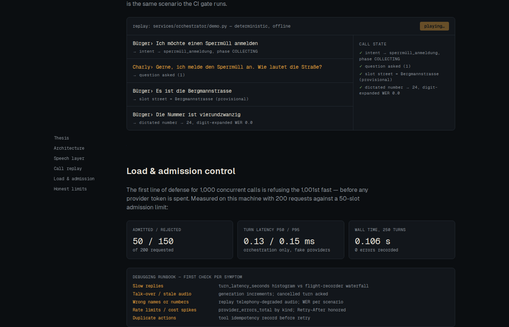
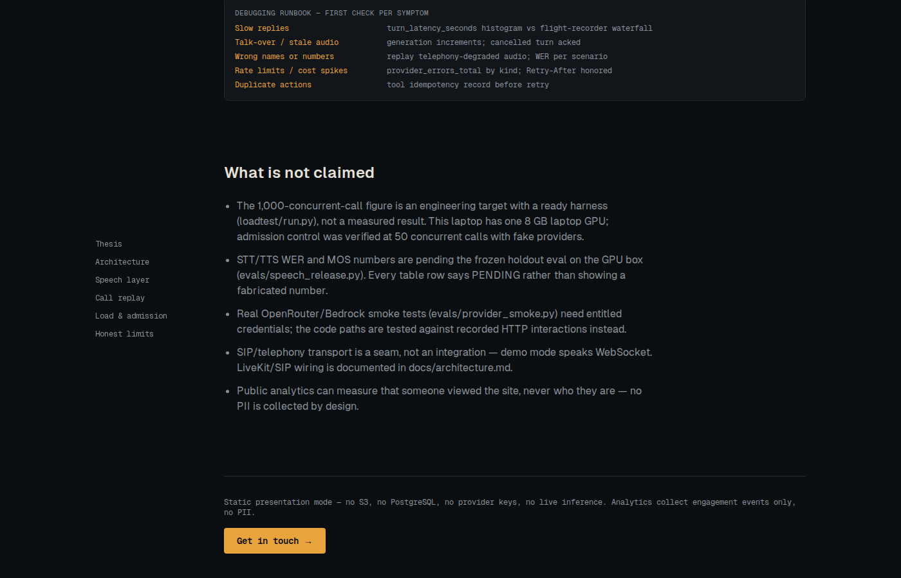

# VoiceAI: a real-time voice-agent systems lab

A production-style engineering project for **real-time conversational voice agents** — the kind that answer phone calls, handle interruptions, remember what you said, and ground their answers in a knowledge base. The reference domain is German municipal phone service (24/7, 30+ languages, EU-hosted), but nothing in the architecture is domain-specific: the same pipeline serves appointment booking, healthcare intake, customer support, or any telephony/voice-assistant workload.

The repository contains two independent deliverables:

- **Full voice system:** Pipecat, FastAPI, pydantic-ai, open STT/TTS, OpenRouter, AWS Bedrock, PostgreSQL/pgvector, S3-compatible storage, evals, and load tooling.
- **Hosted presentation:** a static Vercel site with bundled demo content, an interactive call replay, benchmark evidence, and privacy-conscious analytics.

Live demo-mode site: **https://voiceai-presentation.vercel.app**

## Status

Gate status: **G1–G5 met, G6–G8 blocked** (exact evidence and commands in [GATES.md](GATES.md)).

- 54 backend tests, strict Ruff + Pyright clean, deterministic German voice demo passing (`LOCAL_VOICE_DEMO_PASSED`).
- Admission control measured on this machine: 50 concurrent calls, 200 requested, 150 fast-busy rejections, 0 errors (orchestration-only, fake providers — not a 1,000-call claim).
- Not claimed: 1,000 concurrent media calls (needs the production GPU fleet), live OpenRouter/Bedrock smoke (needs credentials), speech WER/MOS numbers (needs the GPU-box holdout eval). Each has a runnable entry point that fails honestly until unblocked.

## Design summary

```text
WebRTC or SIP/RTP
       ↓
Pipecat real-time runtime (per-call PipelineWorker)
       ↓
Streaming STT → typed call state/context → pydantic-ai agent/tools → streaming TTS
                         │                         │
                PostgreSQL/pgvector          Bedrock/OpenRouter
                         │
                S3-compatible originals
```

Design principles, applicable to any voice-agent product:

1. **Eval-gated releases** — no model ships without beating the pinned baseline on a frozen, telephony-degraded, leakage-safe holdout (`evals/speech_release.py`).
2. **Contracts over vendors** — `SpeechProvider`/`LLMProvider` protocols let OpenRouter, Bedrock, or a self-hosted vLLM endpoint swap without touching orchestration.
3. **Single-writer state** — one typed `CallStateMachine` per call; barge-in bumps a generation counter and stale deltas are dropped, so the agent never talks over itself or re-asks answered questions.
4. **Admission before spend** — calls beyond capacity get a fast busy before a single provider token is spent; latency tails stay predictable under load.
5. **Measured or marked pending** — every benchmark number on the site and in these docs is either reproduced by a printed command or labeled PENDING with the blocker.

## The presentation site (screenshots)

| | |
|---|---|
| Thesis + verified metric cards — every claim carries its reproducing command and a MEASURED/PENDING badge |  |
| Interactive architecture explorer — each node explains why it exists |  |
| Open speech-model comparison — telephony-conditioned, honest PENDING rows |  |
| Synchronized call replay — transcript + call-state waterfall, same scenario CI runs |  |
| Load & admission control — measured numbers plus the debugging runbook's first checks |  |
| "What is not claimed" — the limitations section, on the site and in this README |  |

## Benchmarks vs. other voice-AI systems

[docs/benchmarks.md](docs/benchmarks.md) compares this repo's evaluation methodology against hosted platforms (Vapi, Retell, Bland, Synthflow) and model APIs (OpenAI Realtime, Deepgram, AssemblyAI), including vendor-published latency/WER figures with sources — clearly labeled as as-advertised numbers, not independent measurements. The short version:

- Commercial platforms publish voice-to-voice latency and WER measured on **their** audio; this repo measures on **your** telephony-degraded audio with speaker-leakage-safe splits.
- Where this repo wins today is methodology (reproducible, CI-gated, leakage-safe evals); where vendors still win is raw published latency numbers, because this repo refuses to publish unmeasured figures.

## Quick start

```bash
uv sync                                    # install backend deps
uv run pytest -q                           # 54 tests
uv run python -m services.orchestrator.demo  # full German call scenario → LOCAL_VOICE_DEMO_PASSED
uvicorn services.api.main:app              # API + WebSocket call replay + /metrics

npm --prefix apps/web install && npm --prefix apps/web run build
node scripts/verify-presentation.mjs       # G4: bundle safety
```

## Documents

- [Architecture and decisions](docs/architecture.md)
- [Implementation plan](docs/implementation-plan.md)
- [Evaluation and capacity](docs/evaluation.md)
- [Benchmarks vs. other voice-AI systems](docs/benchmarks.md)
- [Presentation and analytics](docs/presentation.md)
- [Debugging runbook](docs/runbook.md)
- [Executable acceptance gates](GATES.md)

## Engineering targets

Targets, not measured claims:

- p95 caller-end-to-first-audio below 1.5 seconds.
- p95 barge-in-to-silence below 250 ms.
- At least 99% successful completed test calls.
- No stale audio after cancellation.
- 1,000 simultaneous calls only after a named-hardware load test with 30% headroom.

## Privacy

Use synthetic or consented data. Keep credentials out of Git, logs, browser code, analytics properties, and demo artifacts. Apply tenant and authorization filters before retrieval. Public analytics cannot prove that a company or individual reviewer visited.
